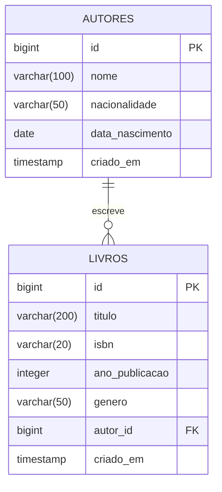

# Biblioteca Web

Sistema web para cadastro de **Autores** e **Livros** (CRUD completo dos dois).
Cada livro é escrito por **um** autor e um autor pode ter **vários** livros: relacionamento **1 : N**.

Exercício em dupla – Parte 2 – Laboratório (19/11/2026) – Engenharia de Software – Prof. Sandro Laudares.
O projeto repete o fluxo da **Agenda Web** (Contato 1 → N Compromisso), agora com **Autor 1 → N Livro**.

| Dupla | Papel |
|-------|-------|
| **Felipe Costa** | DEV 1 – Autores (`feature/autores`) |
| **Iasmin Oliveira** | DEV 2 – Livros (`feature/livros`) |

---

## Tecnologias

| Camada | Tecnologia / versão |
|--------|---------------------|
| Backend | Java 17 + Spring Boot 3.2 (Web, Data JPA, Validation, Lombok) + Maven |
| Frontend | React 18 + React Router 6 + Axios (react-scripts 5) • Node.js 20 + npm |
| Banco de dados | PostgreSQL 15 (desenvolvimento) • H2 em memória (perfil `test`) |
| Testes | JUnit 5 + Mockito (`@WebMvcTest`, `@MockBean`, MockMvc) • `@SpringBootTest` • Jest • JaCoCo (cobertura) |
| Documentação da API | Swagger UI (springdoc-openapi) |
| Versão / CI / Containers | Git + GitHub • GitHub Actions • Docker + Docker Compose |

---

## Modelagem (diagrama ER)



A chave estrangeira `autor_id` fica na tabela **livros** (o lado "N"). No código, o relacionamento fica só em `Livro.java`:

```java
@NotNull
@ManyToOne(fetch = FetchType.EAGER)
@JoinColumn(name = "autor_id", nullable = false) // cria a coluna FK
private Autor autor;
```

`Autor.java` **não** tem `List<Livro>`, para o JSON não entrar em loop infinito (Autor → Livros → Autor…).

### Campos e regras

| Entidade | Campo Java | Coluna | Tipo Java | Regras |
|----------|-----------|--------|-----------|--------|
| Autor | `id` | `id` | Long | PK, gerado automaticamente |
| Autor | `nome` | `nome` | String | obrigatório (`@NotBlank`), máx. 100 |
| Autor | `nacionalidade` | `nacionalidade` | String | opcional, máx. 50 |
| Autor | `dataNascimento` | `data_nascimento` | LocalDate | opcional (formato `AAAA-MM-DD`) |
| Autor | `criadoEm` | `criado_em` | LocalDateTime | preenchido automaticamente (`@PrePersist`) |
| Livro | `id` | `id` | Long | PK, gerado automaticamente |
| Livro | `titulo` | `titulo` | String | obrigatório (`@NotBlank`), máx. 200 |
| Livro | `isbn` | `isbn` | String | opcional, máx. 20 |
| Livro | `anoPublicacao` | `ano_publicacao` | Integer | opcional |
| Livro | `genero` | `genero` | String | opcional, máx. 50 |
| Livro | `autor` | `autor_id` (FK) | Autor | obrigatório (`@NotNull`), `@ManyToOne` |
| Livro | `criadoEm` | `criado_em` | LocalDateTime | preenchido automaticamente (`@PrePersist`) |

---

## Arquitetura

```
React 18 (telas, Nginx)  --Axios / HTTP JSON-->  Controller (@RestController)
                                                     |
                                                   chama
                                                     v
                                              Repository (JpaRepository)  --JPA/Hibernate-->  PostgreSQL 15
```

O React chama a API REST. O **Controller** recebe a requisição e usa o **Repository**, que grava e lê as **entidades** (model) no PostgreSQL.

---

## Estrutura do projeto

```
biblioteca-web/
├── backend/
│   ├── pom.xml                      # dependências e build Maven (Spring Boot 3.2, Java 17, JaCoCo)
│   ├── Dockerfile                   # imagem do backend (build Maven + JRE 17)
│   └── src/
│       ├── main/java/com/biblioteca/
│       │   ├── BibliotecaApplication.java
│       │   ├── model/               # Autor.java, Livro.java (entidades JPA = tabelas)
│       │   ├── repository/          # AutorRepository, LivroRepository (JpaRepository)
│       │   └── controller/          # AutorController, LivroController (API REST)
│       ├── main/resources/
│       │   └── application.properties        # conexão com o PostgreSQL (biblioteca_db)
│       └── test/
│           ├── java/com/biblioteca/
│           │   ├── controller/      # AutorControllerTest, LivroControllerTest (MockMvc + Mockito)
│           │   └── IntegracaoTest.java        # teste de integração (@SpringBootTest)
│           └── resources/
│               └── application-test.properties  # H2 em memória (perfil test)
├── frontend/
│   ├── package.json, package-lock.json
│   ├── Dockerfile, nginx.conf       # build do React + Nginx
│   ├── public/index.html
│   └── src/
│       ├── App.js, App.css          # menu e rotas (React Router)
│       ├── services/api.js          # autorService e livroService (Axios)
│       └── components/              # AutorList, AutorForm, LivroList, LivroForm (+ testes Jest)
├── docker-compose.yml               # sobe postgres, backend e frontend juntos
├── .github/workflows/ci-cd.yml      # pipeline CI/CD (GitHub Actions)
└── README.md
```

---

## Endpoints REST

URL base: `http://localhost:8080`

| Verbo | URL | O que faz | Status |
|-------|-----|-----------|--------|
| POST | `/api/autores` | Cria um autor | 201 (400 se inválido) |
| GET | `/api/autores` | Lista todos (ordem: nome) | 200 |
| GET | `/api/autores/{id}` | Busca um autor | 200 / 404 |
| PUT | `/api/autores/{id}` | Atualiza um autor | 200 / 404 |
| DELETE | `/api/autores/{id}` | Remove um autor | 200 / 404 / **409** se o autor tiver livros |
| POST | `/api/livros` | Cria um livro ligado a um autor | 201 (400 se inválido ou autor inexistente) |
| GET | `/api/livros` | Lista todos (ordem: título) | 200 |
| GET | `/api/livros/{id}` | Busca um livro | 200 / 404 |
| PUT | `/api/livros/{id}` | Atualiza um livro (inclusive o autor) | 200 / 404 |
| DELETE | `/api/livros/{id}` | Remove um livro | 200 / 404 |
| GET | `/api/livros/autor/{autorId}` | Lista os livros de um autor | 200 |

Swagger UI: <http://localhost:8080/swagger-ui.html>

### Exemplos com curl

```bash
# Criar um autor
curl -X POST http://localhost:8080/api/autores \
  -H "Content-Type: application/json" \
  -d '{"nome": "Machado de Assis", "nacionalidade": "Brasileira", "dataNascimento": "1839-06-21"}'

# Criar um livro vinculado ao autor 1 (o autor vai só com o id)
curl -X POST http://localhost:8080/api/livros \
  -H "Content-Type: application/json" \
  -d '{"titulo": "Dom Casmurro", "isbn": "978-8535910667", "anoPublicacao": 1899, "genero": "Romance", "autor": {"id": 1}}'

# Listar os livros do autor 1
curl http://localhost:8080/api/livros/autor/1
```

---

## Como executar

### Opção 1 – Tudo com Docker (recomendado)

Pré-requisito: Docker + Docker Compose.

```bash
docker-compose up -d --build
```

| Serviço | Endereço |
|---------|----------|
| Frontend (React + Nginx) | <http://localhost:3000> |
| Backend (API REST) | <http://localhost:8080/api/autores> |
| Swagger | <http://localhost:8080/swagger-ui.html> |
| PostgreSQL 15 | `localhost:5432` • banco `biblioteca_db` • usuário/senha `postgres`/`postgres` |

Para parar: `docker-compose down` (use `docker-compose down -v` para apagar também os dados do banco).

### Opção 2 – Desenvolvimento local

Pré-requisitos: Java 17, Maven, Node.js 20 e um PostgreSQL 15 (pode ser só o container do compose).

```bash
# 1) Banco de dados
docker-compose up -d postgres

# 2) Backend (porta 8080)
cd backend
mvn spring-boot:run

# 3) Frontend (porta 3000) – em outro terminal
cd frontend
npm install
npm start
```

O frontend usa `http://localhost:8080/api` por padrão. Para trocar, defina `REACT_APP_API_URL` antes do `npm start` / `npm run build`.

---

## Testes

### Backend (JUnit 5 + Mockito + MockMvc)

```bash
cd backend

# Testes unitários dos controllers (@WebMvcTest + @MockBean)
mvn test -Dtest="*ControllerTest"

# Teste de integração (@SpringBootTest + H2 do perfil test)
mvn test -Dtest="IntegracaoTest"

# Todos os testes + relatório de cobertura JaCoCo (backend/target/site/jacoco/index.html)
mvn test
```

| Classe | Testes |
|--------|--------|
| `AutorControllerTest` | criar (201), 404 para id inexistente, 400 com nome em branco, listagem ordenada, buscar, atualizar, 404 ao atualizar, deletar, 404 ao deletar |
| `LivroControllerTest` | criar (201), 404 para id inexistente, 400 sem autor, 400 com autor inexistente, 400 com título em branco, listagem ordenada, listar por autor, atualizar inclusive o autor, 404 ao atualizar, deletar, 404 ao deletar |
| `IntegracaoTest` | `deveVincularLivroAAutor`, `deveExecutarFluxoCompletoAutor` (criar → buscar → atualizar → deletar), `deveAtualizarOAutorDoLivro`, `deveRetornar409AoExcluirAutorComLivros` |

### Frontend (Jest + Testing Library)

```bash
cd frontend
npm test -- --watchAll=false
```

Testes de `AutorList`, `LivroList` (mostra o nome do autor) e `LivroForm` (select de autores), com o `services/api.js` mockado.

---

## CI/CD (GitHub Actions)

Arquivo: `.github/workflows/ci-cd.yml`. Roda a cada **push** e **pull request** na `main`.

| Job | O que faz |
|-----|-----------|
| `test-backend` | Java 17 • `mvn test` (unitários, integração e JaCoCo) • publica o relatório de cobertura como artefato |
| `test-frontend` | Node 20 • `npm ci` • `npm test` • `npm run build` |
| `deploy` (extra) | Só no push na `main`: `docker compose build` + `up`, e testes de aceitação com `curl` (cria um autor e um livro vinculado) |

O deploy na AWS (ECR/ECS/RDS) não foi feito porque precisa de conta e credenciais (não é exigido no exercício).

---

## Divisão de trabalho

| Integrante | Branch | Responsabilidade |
|------------|--------|------------------|
| **Felipe Costa** (DEV 1) | `feature/autores` | Estrutura inicial do projeto • configuração do banco (`application.properties`, `application-test.properties`) • `Autor.java`, `AutorRepository`, `AutorController`, `AutorControllerTest` • `autorService` no `api.js` • `AutorList.js`, `AutorForm.js` e rotas de autores no `App.js` • Dockerfiles, `nginx.conf` e `docker-compose.yml` |
| **Iasmin Oliveira** (DEV 2) | `feature/livros` | `Livro.java`, `LivroRepository`, `LivroController`, `LivroControllerTest` • `IntegracaoTest` • `livroService` no `api.js` • `LivroList.js`, `LivroForm.js` (select de autores) e rotas de livros no `App.js` • CI (`ci-cd.yml`) e `README.md` |

Cada integrante abre um **Pull Request** da sua branch para a `main`, e o outro faz o **Code Review** e o merge.

### Fluxo Git

```bash
git checkout -b feature/autores            # ou feature/livros
git add . && git commit -m "feat: ..."      # commits pequenos: feat:, test:, chore:, ci:, docs:
git push origin feature/autores
# Pull Request -> Code Review -> Merge
git checkout main && git pull origin main
```

---

## Problemas comuns

- **Erro de conexão com o banco:** o PostgreSQL está rodando? O banco é `biblioteca_db`, usuário/senha `postgres`/`postgres`.
- **Erro de CORS no navegador:** os controllers têm `@CrossOrigin(origins = "*")`.
- **Livro salvo sem autor:** o JSON precisa ter `"autor": {"id": 1}`.
- **Datas:** o formato aceito é `AAAA-MM-DD` (ex.: `1839-06-21`).
- **Excluir autor que tem livros:** a FK protege os dados e a API devolve **409** com uma mensagem. Exclua os livros antes.
